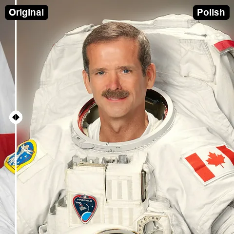
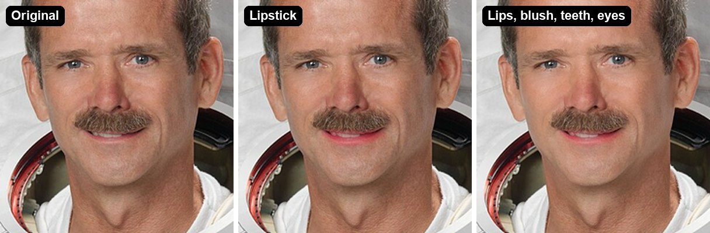
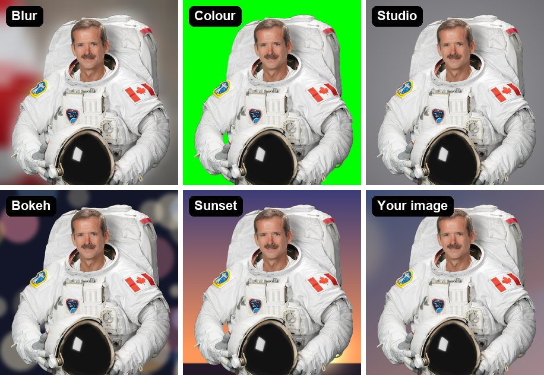

<div align="center">

# Polish for OBS

**Free, open-source beauty and camera effects for [OBS Studio](https://obsproject.com).**<br>
Skin smoothing, makeup, face shape, 17 colour looks, background blur or replacement and
face-tracked stickers. Windows, macOS and Linux. No watermark, no account, nothing uploaded.

[](https://github.com/TYFSADIK/obs-polish/actions/workflows/build.yml)
[](https://github.com/TYFSADIK/obs-polish/releases/latest)
[](https://github.com/TYFSADIK/obs-polish/releases)
[](LICENSE)




</div>

## Download

| | Download | Install |
| --- | --- | --- |
| **Windows** 10 and 11, x64 | [obs-polish-windows-x64.zip](https://github.com/TYFSADIK/obs-polish/releases/latest/download/obs-polish-windows-x64.zip) | unzip, double-click **Install Polish.cmd** |
| **Windows** on ARM | [obs-polish-windows-arm64.zip](https://github.com/TYFSADIK/obs-polish/releases/latest/download/obs-polish-windows-arm64.zip) | unzip, double-click **Install Polish.cmd** |
| **macOS** 12 and later, Apple silicon and Intel | [obs-polish-macos-universal.zip](https://github.com/TYFSADIK/obs-polish/releases/latest/download/obs-polish-macos-universal.zip) | unzip, double-click **Install Polish.command** (if macOS blocks it: right-click, Open) |
| **Linux** x86_64 | [obs-polish-linux-x86_64.tar.gz](https://github.com/TYFSADIK/obs-polish/releases/latest/download/obs-polish-linux-x86_64.tar.gz) | extract, run `./install.sh` (also installs into the Flatpak OBS if you have it) |
| **Linux** ARM64 | [obs-polish-linux-aarch64.tar.gz](https://github.com/TYFSADIK/obs-polish/releases/latest/download/obs-polish-linux-aarch64.tar.gz) | extract, run `./install.sh` |

Works with **OBS 30, 31, 32 and 33**. Restart OBS after installing, then choose
**Tools > Polish: beauty and effects**: it adds the filter to your camera and opens its settings.
Or right-click any video source, **Filters**, **+**, **Polish**.

Polish also works in Zoom, Teams, Meet and Discord through OBS's **Start Virtual Camera**.

## What it does

| | |
| --- | --- |
| **Beauty** | edge-preserving skin smoothing, only on skin inside the tracked face; brightening that keeps skin's own colour; sharpening |
| **Makeup** | lipstick and blush in any colour, teeth whitening, eye brightening |
| **Face shape** | slimmer jaw and bigger eyes, from 468 face landmarks |
| **Colour** | 17 looks: Portrait (Rosy, Fresh, Porcelain), Food (Appetizing), Landscape (Lush, Sunset), Modern (Cinematic, Noir, Vintage), Warm, Cool, Golden hour, Vivid, Pastel, Teal and orange, Mono, Film; strength, exposure, warmth, saturation, vignette, film grain |
| **Background** | blur, a solid colour (a green screen without the green screen), Studio, Gradient, Bokeh lights or Sunset backdrops, or your own image |
| **Stickers** | sunglasses, star glasses, crown, flower crown, cat ears, bunny ears, devil horns, halo, hearts, party hat; they follow your head as it moves and tilts |
| **Compare** | a checkbox, and a hotkey you hold to see the original (**Settings > Hotkeys**) |
| **Languages** | follows OBS: English, French, Spanish, German, Portuguese, Chinese, Japanese, Korean |

<table>
<tr><td></td></tr>
<tr><td align="center">Beauty at full strength (the defaults are gentler)</td></tr>
<tr><td></td></tr>
<tr><td align="center">Makeup: lipstick, then lipstick with blush, whiter teeth and brighter eyes</td></tr>
<tr><td></td></tr>
<tr><td align="center">Background: blur, colour, three built-in backdrops, your own image</td></tr>
<tr><td></td></tr>
<tr><td align="center">7 of the 17 looks, and vignette with film grain</td></tr>
<tr><td></td></tr>
<tr><td align="center">6 of the 10 stickers</td></tr>
</table>

## Private and light

- **Everything runs on your computer.** No account, no internet connection, no telemetry, no
  watermark. The face models ship inside the plugin.
- **Light on the GPU:** about 2 ms per 1080p frame with every effect on (Apple silicon Mac,
  measured inside OBS's own engine). Effects that are switched off cost nothing.
- **Never stalls a frame.** Face analysis runs on its own thread on a small copy of the frame;
  if it is busy, that frame keeps the last result.

## How it works

```
camera ─┬─► smooth + brighten ─► makeup ─► face shape ─► background ─► look, vignette, grain ─► sticker ─► OBS
        │          ▲                ▲          ▲              ▲                                    ▲
        └─► 384 px copy ─► face analysis (its own thread): 468 landmarks, lips, person mask
```

| | Windows, Linux | macOS |
| --- | --- | --- |
| Face analysis | Google's MediaPipe face detection, face mesh and selfie segmentation on [ONNX Runtime](https://onnxruntime.ai), CPU | Apple's Vision framework, built into macOS |
| Effects | the same GPU shaders in OBS's effect language: Direct3D 11 on Windows, OpenGL on Linux, OpenGL or Metal on macOS | |

The models' sources and checks are in [data/models/PROVENANCE.md](data/models/PROVENANCE.md):
the face models were converted from Google's official files and match them to about one part
in a million.

## Tested on every platform

Every push builds all five packages and runs the same 14 pixel checks inside a real OBS on each
platform (no window; [tests/run_tests.py](tests/run_tests.py)):

| Platform | OBS | Graphics |
| --- | --- | --- |
| Windows x64 and ARM64 | 33.0.3, official release | Direct3D 11 |
| Linux x86_64 | newest, OBS Project PPA | OpenGL (Mesa) |
| Linux ARM64 | **30.0.2**, Ubuntu's own package: the oldest supported | OpenGL (Mesa) |
| macOS (Apple silicon) | 33.0.3, official release | OpenGL and Metal; Vision and ONNX backends |

The checks include: with every effect off the picture is unchanged to the pixel; the face is
found; smoothing halves skin detail and leaves the background alone; brightening keeps skin's
hue; face shape only moves pixels near the face; lipstick only touches the mouth; the background
modes replace the background and keep the person; compare shows the original exactly.

## Build from source

```bash
./scripts/fetch-deps.sh                  # libobs 30.0 headers and SIMDe
cmake -S . -B build -DCMAKE_BUILD_TYPE=Release
cmake --build build
```

Windows and Linux also need ONNX Runtime (`scripts/fetch-onnxruntime.py`); see
[CONTRIBUTING.md](CONTRIBUTING.md) for every platform and for running the tests.

## Repository map

```
src/                plugin entry, Tools menu, hotkey; the filter; analyzer core; Vision and ONNX backends; image loading
data/effects/       the shaders
data/models/        MediaPipe models (ONNX) and their provenance
data/luts, stickers, backgrounds    generated by tools/make_assets.py
data/locale/        translations
tests/              headless libobs render test (C) and the checks
scripts/            dependencies, packaging, installers
tools/              asset generator, model converter
```

## Credits and licence

MIT licence. Face models by Google (MediaPipe, Apache 2.0); ONNX Runtime by Microsoft (MIT);
image loading by stb (public domain). Details in [THIRD_PARTY_NOTICES.md](THIRD_PARTY_NOTICES.md).
Test portrait: Chris Hadfield, NASA (public domain). Not affiliated with the OBS Project.
