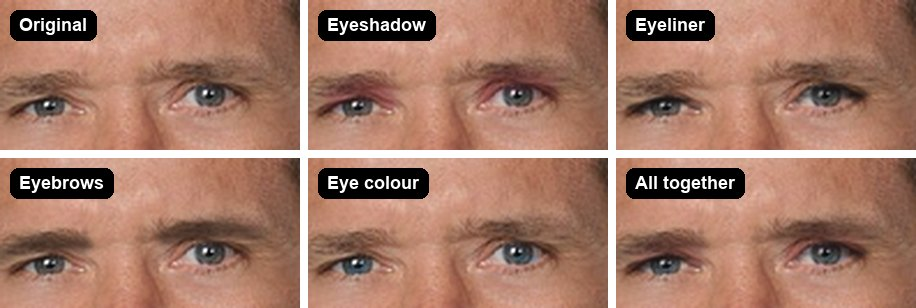
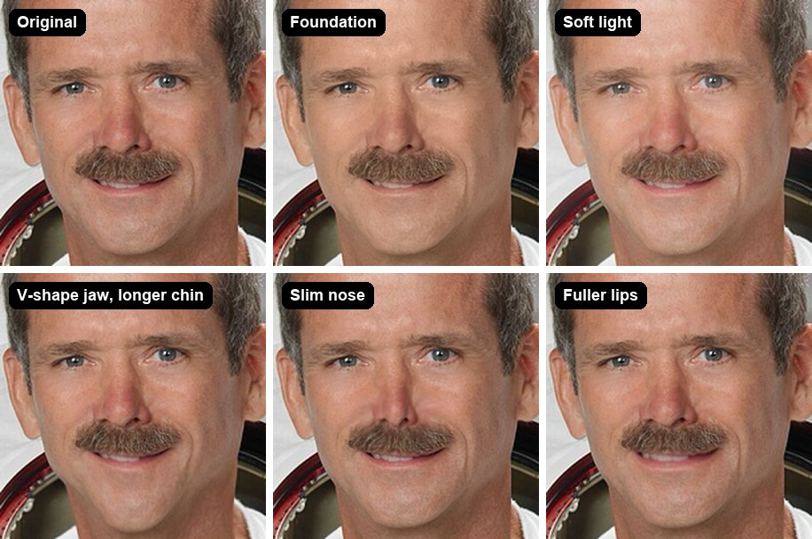
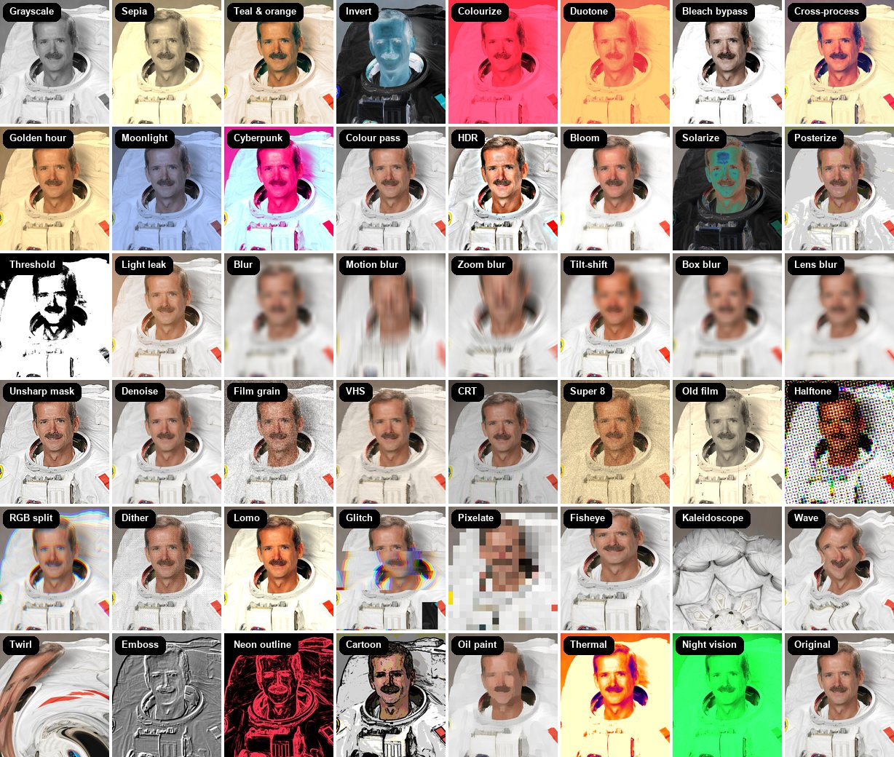

<div align="center">

# Polish for OBS

**Free, open-source beauty and camera effects for [OBS Studio](https://obsproject.com).**<br>
Skin smoothing, foundation, soft light, makeup (lips, blush, eyeshadow, eyeliner, brows, eye
colour), face shape (jaw, chin, nose, eyes, lips), 17 colour looks, 47 effects (from film grain,
VHS and halftone to glitch, thermal and echo trails), background blur or replacement and
face-tracked stickers. Windows, macOS and Linux. No watermark, no account, nothing uploaded.

[](https://github.com/TYFSADIK/obs-polish/actions/workflows/build.yml)
[](https://github.com/TYFSADIK/obs-polish/releases/latest)
[](https://github.com/TYFSADIK/obs-polish/releases)
[](LICENSE)


</div>

## Download

| | Download | Install |
| --- | --- | --- |
| **Windows** 10 and 11, x64 | [obs-polish-windows-x64.zip](https://github.com/TYFSADIK/obs-polish/releases/latest/download/obs-polish-windows-x64.zip) | unzip, double-click **Install Polish.cmd** |
| **Windows** on ARM | [obs-polish-windows-arm64.zip](https://github.com/TYFSADIK/obs-polish/releases/latest/download/obs-polish-windows-arm64.zip) | unzip, double-click **Install Polish.cmd** |
| **macOS** 12 and later, Apple silicon and Intel | [obs-polish-macos-universal.zip](https://github.com/TYFSADIK/obs-polish/releases/latest/download/obs-polish-macos-universal.zip) | unzip, double-click **Install Polish.command** (if macOS blocks it: right-click, Open) |
| **Linux** x86_64 | [obs-polish-linux-x86_64.tar.gz](https://github.com/TYFSADIK/obs-polish/releases/latest/download/obs-polish-linux-x86_64.tar.gz) | extract, run `./install.sh` (also installs into the Flatpak OBS if you have it) |
| **Linux** ARM64 | [obs-polish-linux-aarch64.tar.gz](https://github.com/TYFSADIK/obs-polish/releases/latest/download/obs-polish-linux-aarch64.tar.gz) | extract, run `./install.sh` |

Works with **OBS 30, 31, 32 and 33**. Step-by-step instructions for each system are below.

## Install

Install OBS Studio first ([obsproject.com](https://obsproject.com)), and close it before installing Polish.

### Windows (10 and 11, x64 or ARM)

1. Download the zip for your PC: **x64** for almost all PCs, **ARM64** for Windows on ARM
   (Snapdragon laptops). Not sure? *Settings > System > About > System type*.
2. Right-click the zip, **Extract All...**, and open the extracted folder. (The installer cannot
   run from inside the zip.)
3. Double-click **Install Polish.cmd**.
   - If Windows shows *"Windows protected your PC"*: click **More info**, then **Run anyway**.
     Polish is not code-signed, which costs money every year; the source is all here.
   - Click **Yes** when Windows asks for administrator rights: OBS reads plugins from
     `C:\ProgramData\obs-studio\plugins`, which is shared by every user on the PC.
4. Start OBS.

**Manual install:** copy the `obs-polish` folder from the zip into
`C:\ProgramData\obs-studio\plugins\` (create the folders if they do not exist).

### macOS (12 Monterey and later, Apple silicon or Intel)

1. Download **obs-polish-macos-universal.zip** and double-click it to unzip.
2. Double-click **Install Polish.command** in the unzipped folder.
   - If macOS says it *"cannot be opened"* or *"cannot verify the developer"*: open
     **System Settings > Privacy & Security**, scroll down, click **Open Anyway** next to the
     message, then confirm. (On macOS 14 and earlier you can also right-click the file and choose
     **Open**.) Polish is not notarised by Apple, which needs a paid developer account.
3. A Terminal window says where it was installed; close it and start OBS.

**Manual install:** copy `obs-polish.plugin` into
`~/Library/Application Support/obs-studio/plugins/` (in Finder: **Go > Go to Folder...** and
paste the path; create `plugins` if it does not exist). Then run
`xattr -dr com.apple.quarantine ~/Library/Application\ Support/obs-studio/plugins/obs-polish.plugin`
in Terminal so macOS lets OBS load it.

### Linux (x86_64 or ARM64)

```bash
tar xzf obs-polish-linux-x86_64.tar.gz        # or obs-polish-linux-aarch64.tar.gz
cd obs-polish-*/
./install.sh
```

The script installs for your user into `~/.config/obs-studio/plugins/obs-polish`, which works
with OBS from your distribution, the OBS Project's PPA, or a build from source. If you use the
**Flatpak** OBS (`com.obsproject.Studio`), it installs there too
(`~/.var/app/com.obsproject.Studio/config/obs-studio/plugins/obs-polish`). No `sudo` needed.

The Snap version of OBS has not been tested.

## Use

1. Start OBS and add your camera if you have not: **Sources > + > Video Capture Device**.
2. Choose **Tools > Polish: beauty and effects**. Polish is added to the selected source (or the
   first camera in the scene) and its settings open.
   Or: right-click the source, **Filters**, **+** under *Effect Filters*, **Polish**.
3. Move the sliders; the preview updates as you go. Tick **Compare with original** to check the
   difference. Effects you leave at 0 cost nothing.
4. To hold a key for a quick before/after: **Settings > Hotkeys > Polish: hold to compare with
   original**.

**In Zoom, Teams, Google Meet, Discord and others:** click **Start Virtual Camera** in OBS's
Controls, then choose **OBS Virtual Camera** as the camera in the other app.

**Your own background picture:** **Background > Image**, then **Background: My own image**, and
pick a PNG or JPEG.

## Uninstall

Close OBS and delete the folder:

| | Delete |
| --- | --- |
| Windows | `C:\ProgramData\obs-studio\plugins\obs-polish` |
| macOS | `~/Library/Application Support/obs-studio/plugins/obs-polish.plugin` |
| Linux | `~/.config/obs-studio/plugins/obs-polish` (and the Flatpak path above, if you used it) |

## Troubleshooting

| Problem | What to do |
| --- | --- |
| No **Polish** in Tools or in the filter list | Restart OBS after installing. Check **Help > About** shows OBS 30 or later. Check the folder is in the place listed under *Install*. |
| Still not there | **Help > Log Files > View Current Log**, search for `obs-polish`. A line `[obs-polish] loaded, version ...` means it loaded; any other line says why not. |
| A red message in Polish's settings | Face analysis could not start, and the message says why (usually a damaged install: reinstall). Looks, colour and sharpening still work. |
| Effects that need a face do nothing | They need a face to be found: face the camera with even light. Smoothing, makeup, face shape and stickers follow faces; looks and background do not. |
| The background edge shimmers | Raise **Edge softness**; a plain, evenly lit background helps most. |
| Anything else | [Open an issue](https://github.com/TYFSADIK/obs-polish/issues/new/choose) with your OS, OBS version and the log link (**Help > Log Files > Upload Current Log File**). |

## What it does

| | |
| --- | --- |
| **Beauty** | edge-preserving skin smoothing, only on skin inside the tracked face; brightening that keeps skin's own colour; foundation that evens tone towards a shade you pick; soft light; sharpening |
| **Makeup** | lipstick, blush, eyeshadow, eyeliner, eyebrows and eye colour, each in any colour; teeth whitening, eye brightening |
| **Face shape** | slim face, V-shape jaw, chin length, slim nose, bigger eyes and fuller lips, from the face landmarks |
| **Colour** | 17 looks: Portrait (Rosy, Fresh, Porcelain), Food (Appetizing), Landscape (Lush, Sunset), Modern (Cinematic, Noir, Vintage), Warm, Cool, Golden hour, Vivid, Pastel, Teal and orange, Mono, Film; strength, exposure, contrast, warmth, saturation, vignette (darker or lighter corners), film grain |
| **Effects** | 47, each with a strength: **colour** (grayscale, sepia, teal and orange, invert, colourize, duotone, bleach bypass, cross-process, golden hour, moonlight, cyberpunk, colour pass), **light** (HDR, bloom, solarize, posterize, threshold, light leak), **blur** (blur, motion, zoom, tilt-shift, box, lens blur, unsharp mask, denoise), **retro** (film grain, VHS, CRT, Super 8, old film, halftone, RGB split, dither, lomo), **stylize** (glitch, pixelate, fisheye, mirror and kaleidoscope, wave, twirl, emboss, neon outline, cartoon, oil paint, thermal, night vision, echo trails) |
| **Background** | blur, a solid colour (a green screen without the green screen), Studio, Gradient, Bokeh lights or Sunset backdrops, or your own image |
| **Stickers** | sunglasses, star glasses, crown, flower crown, cat ears, bunny ears, devil horns, halo, hearts, party hat; they follow your head as it moves and tilts |
| **Compare** | a checkbox, and a hotkey you hold to see the original (**Settings > Hotkeys**) |
| **Languages** | follows OBS: English, French, Spanish, German, Portuguese, Chinese, Japanese, Korean |

<table>
<tr><td></td></tr>
<tr><td align="center">Beauty at full strength (the defaults are gentler)</td></tr>
<tr><td></td></tr>
<tr><td></td></tr>
<tr><td></td></tr>
<tr><td align="center">Makeup: lipstick, then lipstick with blush, whiter teeth and brighter eyes</td></tr>
<tr><td></td></tr>
<tr><td></td></tr>
<tr><td align="center">Background: blur, colour, three built-in backdrops, your own image</td></tr>
<tr><td></td></tr>
<tr><td align="center">7 of the 17 looks, and vignette with film grain</td></tr>
<tr><td></td></tr>
<tr><td align="center">6 of the 10 stickers</td></tr>
</table>

## Private and light

- **Everything runs on your computer.** No account, no internet connection, no telemetry, no
  watermark. The face models ship inside the plugin.
- **Light on the GPU:** about 3.6 ms per 1080p frame with every effect on, at once, on a
  MacBook Air M2 with OBS's OpenGL renderer (about 7 ms with its newer Metal renderer), measured
  inside OBS's own engine. An effect from the Effects group adds 0.2 to 2.4 ms (lens blur is the
  most). Anything switched off costs nothing.
- **Never stalls a frame.** Face analysis runs on its own thread on a small copy of the frame;
  if it is busy, that frame keeps the last result.

## How it works

```
camera ─┬─► smooth, brighten, foundation ─► makeup ─► face shape ─► background ─► soft light ─► look, vignette, grain ─► sticker ─► effect ─► OBS
        │               ▲                     ▲          ▲              ▲                                                ▲
        └─► 384 px copy ─► face analysis (its own thread): landmarks, lips, eyes, brows, iris, person mask
```

| | Windows, Linux | macOS |
| --- | --- | --- |
| Face analysis | Google's MediaPipe face detection, face mesh and selfie segmentation on [ONNX Runtime](https://onnxruntime.ai), CPU | Apple's Vision framework, built into macOS |
| Effects | the same GPU shaders in OBS's effect language: Direct3D 11 on Windows, OpenGL on Linux, OpenGL or Metal on macOS | |

The models' sources and checks are in [data/models/PROVENANCE.md](data/models/PROVENANCE.md):
the face models were converted from Google's official files and match them to about one part
in a million.

## Tested on every platform

Every push builds all five packages and runs the same 29 pixel checks inside a real OBS on each
platform (no window; [tests/run_tests.py](tests/run_tests.py)):

| Platform | OBS | Graphics |
| --- | --- | --- |
| Windows x64 and ARM64 | 33.0.3, official release | Direct3D 11 |
| Linux x86_64 | newest, OBS Project PPA | OpenGL (Mesa) |
| Linux ARM64 | **30.0.2**, Ubuntu's own package: the oldest supported | OpenGL (Mesa) |
| macOS (Apple silicon) | 33.0.3, official release | OpenGL and Metal; Vision and ONNX backends |

The checks include: with every effect off the picture is unchanged to the pixel; the face is
found; smoothing halves skin detail and leaves the background alone; brightening keeps skin's
hue; face shape only moves pixels near the face; lipstick only touches the mouth; eyeshadow,
eyeliner and eyebrows land above the eyes and eye colour stays inside the irises; foundation
evens skin colour without touching the background; effects stacked together still land where
they should; every one of the 47 effects renders and changes the picture, grayscale has no colour
left, invert is exact, threshold is pure black and white, mirror is symmetric, and echo leaves a
trail; the background modes replace the background and keep the person; compare shows the
original exactly.

## Build from source

```bash
./scripts/fetch-deps.sh                  # libobs 30.0 headers and SIMDe
cmake -S . -B build -DCMAKE_BUILD_TYPE=Release
cmake --build build
```

Windows and Linux also need ONNX Runtime (`scripts/fetch-onnxruntime.py`); see
[CONTRIBUTING.md](CONTRIBUTING.md) for every platform and for running the tests.

## Repository map

```
src/                plugin entry, Tools menu, hotkey; the filter; analyzer core; Vision and ONNX backends; image loading
data/effects/       the shaders
data/models/        MediaPipe models (ONNX) and their provenance
data/luts, stickers, backgrounds    generated by tools/make_assets.py
data/locale/        translations
tests/              headless libobs render test (C) and the checks
scripts/            dependencies, packaging, installers
tools/              asset generator, model converter
```

## Credits and licence

MIT licence. Face models by Google (MediaPipe, Apache 2.0); ONNX Runtime by Microsoft (MIT);
image loading by stb (public domain). Details in [THIRD_PARTY_NOTICES.md](THIRD_PARTY_NOTICES.md).
Test portrait: Chris Hadfield, NASA (public domain). Not affiliated with the OBS Project.
