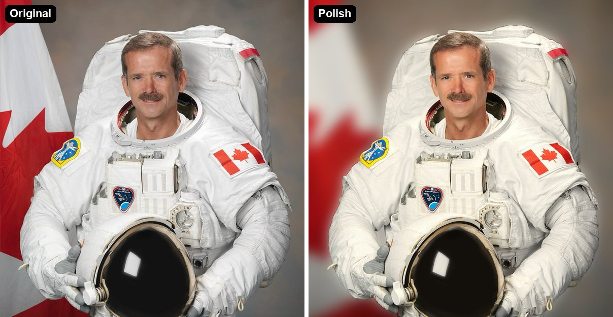
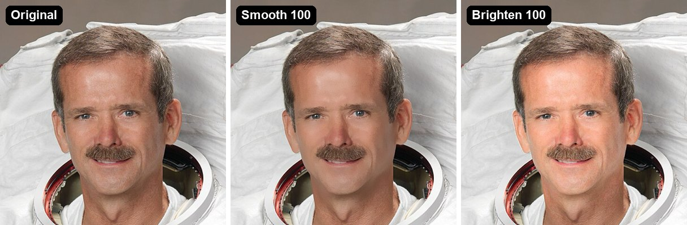
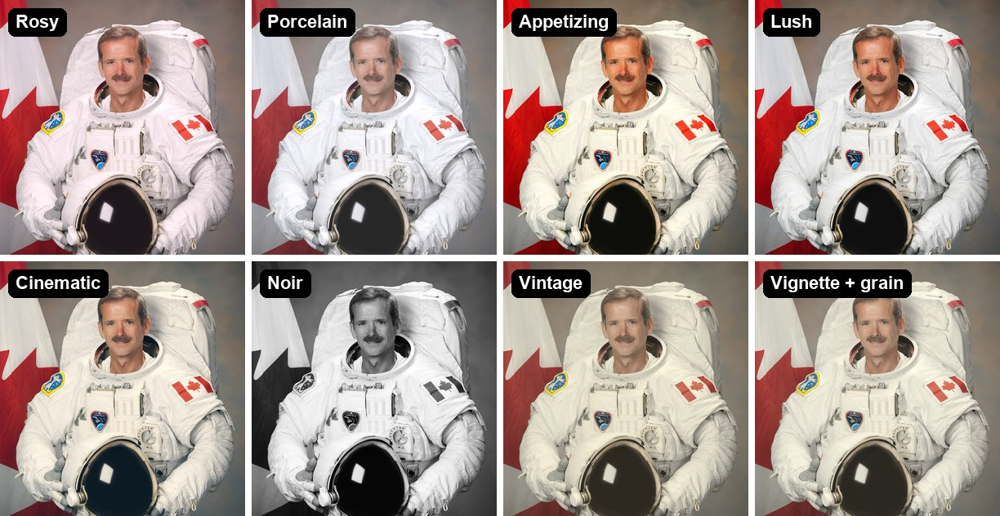
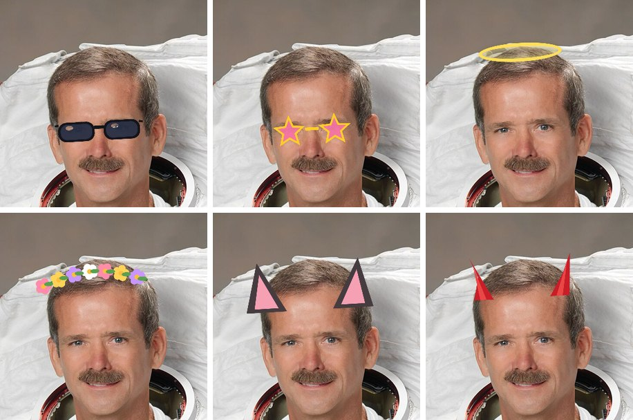

# Polish for OBS

Free, open-source beauty and camera effects for [OBS Studio](https://obsproject.com) on macOS:
skin smoothing, brightening, face shape, makeup, colour looks, background blur or replacement,
and face-tracked stickers. Everything runs on your Mac; nothing is uploaded, there is no account,
and there is no watermark.



| | |
| --- | --- |
| **Beauty** | edge-preserving skin smoothing, limited to skin inside the tracked face; brightening that keeps skin's own colour; sharpening |
| **Face shape** | slimmer jaw and bigger eyes, driven by face landmarks |
| **Makeup** | lipstick and blush in any colour, teeth whitening, eye brightening |
| **Colour** | 17 looks in groups: Portrait (Rosy, Fresh, Porcelain), Food (Appetizing), Landscape (Lush, Sunset), Modern (Cinematic, Noir, Vintage), and Warm, Cool, Golden hour, Vivid, Pastel, Teal and orange, Mono, Film; a strength slider; exposure, warmth, saturation, vignette, film grain |
| **Background** | blur, solid colour (a green screen without the green screen), a built-in backdrop (Studio, Gradient, Bokeh lights, Sunset) or your own image, with adjustable edge softness |
| **Stickers** | sunglasses, star glasses, crown, flower crown, cat ears, bunny ears, devil horns, halo, hearts, party hat; they follow the face and its tilt |
| **Compare** | a checkbox, and a hotkey you hold to see the original |
| **Languages** | follows OBS: English, French, Spanish, German, Portuguese, Chinese, Japanese, Korean |

## Install

1. Download `obs-polish-<version>-macos.zip` from [Releases](../../releases) and unzip it.
2. Double-click `install.command` (if macOS blocks it: right-click, Open). It copies the plugin to
   `~/Library/Application Support/obs-studio/plugins/`.
3. Restart OBS.

Then either choose **Tools > Polish: beauty and effects** (it adds the filter to the selected
source, or the first camera in the scene, and opens its settings), or right-click a camera
source, **Filters**, **+**, **Polish**.

To bind the compare key: **Settings > Hotkeys > Polish: hold to compare with original**.

Requires macOS 12 or later and OBS 30 or later; Apple silicon and Intel.

## What it looks like

Beauty at full strength (the default is gentler: smooth 45, brighten 20):



Makeup:


Background:


Looks (8 of 17), and vignette with grain:



Stickers (6 of 10):



## How it works

```
camera frame ─┬─► smooth + brighten ─► makeup ─► face shape ─► background ─► look, tone, vignette, grain ─► sticker ─► OBS
              │          ▲                ▲          ▲              ▲                                       ▲
              └─► 384 px copy ─► Apple Vision (background thread): face landmarks, lips mask, person mask
```

- **Analysis** uses Apple's Vision framework, which ships with macOS: face landmarks (about 8 to 12 ms
  per frame) and person segmentation (about 15 to 20 ms). For makeup, the lip landmarks are
  rasterised into a small lips and mouth-interior mask with Core Graphics. It runs on a background queue on a
  small copy of the frame, read back one frame late so the GPU never waits; if analysis is busy,
  the frame is skipped and the effects use the latest result. Landmarks are smoothed over time
  against jitter.
- **Effects** are GPU shaders in OBS's effect language ([`data/effects/polish.effect`](data/effects/polish.effect)):
  a skin-weighted bilateral filter inside an ellipse fitted to each face; a luminance curve that
  scales colour with brightness so skin keeps its hue; a displacement field from the jaw
  landmarks (an average of nearby control points, so they never stack) and a local zoom on each
  eye; soft-light lipstick from the lips mask, blush ellipses placed from the cheek landmarks, teeth
  whitening limited to bright, unsaturated pixels inside the mouth; a separable Gaussian blur at
  quarter resolution; mask compositing; a 64-step 3D LUT; vignette and grain.
- **Cost** at 1920 x 1080 on an Apple silicon Mac: about 1.8 ms of GPU time per frame with every
  effect on, on top of OBS's own work (pass-through 1.3 ms, defaults 2.1 ms, beauty with shape and
  makeup 2.6 ms, everything 3.1 ms in the benchmark below).
- **Assets** (looks, stickers and backdrops) are generated by [`tools/make_assets.py`](tools/make_assets.py);
  no third-party art is included.

## Build from source

```bash
./scripts/build.sh          # fetches libobs headers (OBS 33.0.3) and SIMDe, builds build/obs-polish.plugin
./scripts/package.sh        # dist/obs-polish-<version>-macos.zip
```

Needs Xcode command line tools and CMake. The plugin links against OBS at run time, so OBS
does not need to be installed to build it.

## Tests

With OBS installed in `/Applications`, the build also produces `render-test`, which starts a real
libobs headless, runs an image through the filter and writes the result:

```bash
python3 tests/run_tests.py                     # 14 checks; renders go to tests/out/
POLISH_BENCH=1 build/render-test build/obs-polish.plugin <image> out.png '{}' 130    # ms per frame
```

The checks: pass-through is bit-exact with everything off; the face is found with sensible
landmarks; smoothing halves forehead detail and leaves the background untouched; brightening
raises luminance without shifting hue; face shape changes only pixels near the face; background
blur keeps the person and softens the background; solid colour fills it; an identity look changes
nothing; Mono removes colour; a sticker lands above the eyes; lipstick reddens only pixels around
the mouth; vignette darkens the corners and leaves the centre; a built-in backdrop replaces the
background and leaves the face; compare shows the original exactly.

Test portrait: Chris Hadfield, NASA (public domain).

## Limits

- macOS only: analysis uses Apple's Vision framework. A Windows or Linux port would need another
  landmark and segmentation model (for example MediaPipe through ONNX Runtime).
- The person mask is one or two frames behind the picture, so fast movement can show a thin edge.
- Face shape, blush, eye brightening and stickers follow the largest face; smoothing and the
  lips mask cover up to two faces.
- A full moustache or beard can hide part of the upper lip from the lip landmarks.

## Related projects

[GPUPixel](https://github.com/pixpark/gpupixel) (cross-platform C++ beauty library),
[PixelFreeEffects](https://github.com/uu-code007/PixelFreeEffects),
[jeelizFaceFilter](https://github.com/jeeliz/jeelizFaceFilter) (web),
[OpenSeeFace](https://github.com/emilianavt/OpenSeeFace) (face tracking),
and the [obs-backgroundremoval](https://github.com/locaal-ai/obs-backgroundremoval) plugin.

## Repository map

```
src/            plugin entry, Tools menu, hotkey (plugin.c); the filter (polish-filter.c); Vision analysis (analyzer.m)
data/effects/   the shaders
data/luts/      colour looks (generated)
data/stickers/  stickers (generated)
data/backgrounds/ backdrop presets (generated)
data/locale/    translations
tools/          asset generator
tests/          headless libobs render harness and checks
scripts/        fetch deps, build, package, installer
```

MIT licence. Not affiliated with the OBS Project.
